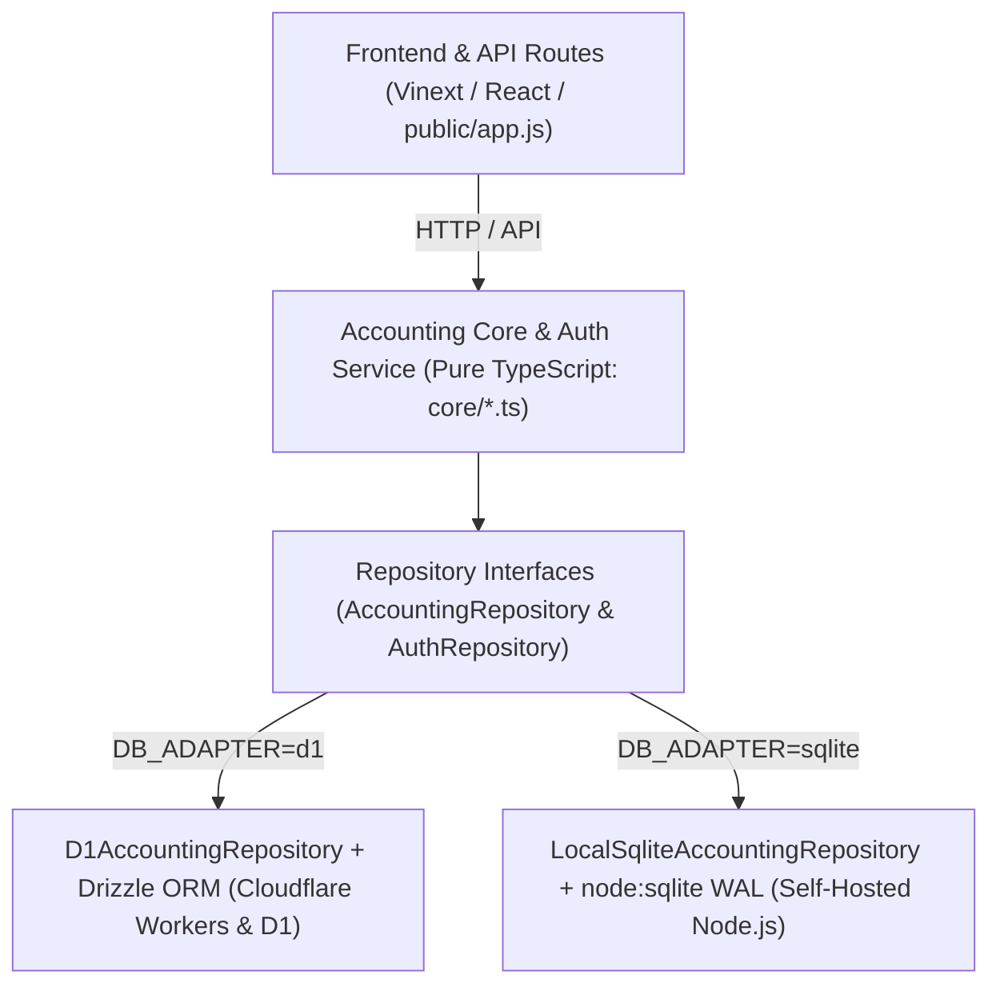

# Bukan Sekadar Catat Pemasukan dan Pengeluaran: Membangun Aplikasi Akuntansi untuk UMKM

**Menggabungkan siklus akuntansi double-entry, persediaan Moving Average, dan arsitektur TypeScript yang terisolasi dalam satu proyek open-source.**

---

> *Catatan sebelum membaca: Seluruh contoh nama usaha (**Aneka Snack**) dan angka transaksi pada artikel maupun live demo merupakan data simulasi untuk pembelajaran dan portofolio, bukan catatan keuangan usaha nyata. Proyek ini masih berada pada tahap pengembangan (`In Development`).*

> **[PENEMPATAN VISUAL 1 — Cover Image Artikel]**  
> *Letakkan di bagian paling atas sebagai sampul artikel Medium.*

---

## 1. Masalah Pembukuan yang Sering Terjadi di UMKM

Banyak pemilik UMKM sebenarnya sudah disiplin mencatat uang masuk dan uang keluar—baik di buku kas harian, spreadsheet sederhana, maupun aplikasi kasir. Masalahnya, catatan arus kas belum cukup ketika usaha mulai tumbuh dan pemilik harus mengambil keputusan bisnis.

Pada titik tertentu, pertanyaan yang muncul bukan lagi "berapa uang yang tersisa di laci hari ini?", melainkan:

- Berapa **laba bersih** bulan ini setelah menghitung harga pokok barang terjual dan beban operasional?
- Berapa nilai **stok bahan baku** dan **barang jadi** yang masih mengendap di gudang?
- Pelanggan mana yang masih memiliki **piutang usaha**, dan tagihan pemasok mana yang masih berstatus **utang usaha**?
- Mengapa saldo kas tampak cukup, padahal usaha sebenarnya merugi atau kewajiban jatuh tempo menumpuk?

Aplikasi pencatatan kas biasa gagal menjawab pertanyaan tersebut karena hanya merekam perpindahan uang. Ketika ada pembelian stok secara kredit, pemakaian bahan baku untuk produksi, pelunasan faktur secara mencicil, atau pembatalan transaksi tanpa menghilangkan jejak historis, pencatatan lepas tidak lagi menjaga keterkaitan angkanya. Akibatnya, laporan keuangan tetap harus dirakit ulang secara manual di akhir bulan dan rentan tidak seimbang.

---

## 2. Ide di Balik Proyek Ini

**UMKM Accounting System** (dengan antarmuka bernama **NeracaKita**) dibangun sebagai proyek portofolio open-source untuk menjembatani dua bidang yang sering berjalan sendiri-sendiri: **logika akuntansi** dan **rekayasa perangkat lunak**.

Kebutuhan awalnya terinspirasi dari operasional usaha kecil makanan ringan (disimulasikan dengan nama fiktif **Aneka Snack**), lalu diperluas agar dapat dipakai untuk alur pembukuan usaha **dagang**, **jasa**, dan **produksi ringan**.

Satu prinsip menjadi pegangan sejak awal: **sistem tidak boleh hanya menyimpan input formulir sebagai catatan mentah.** Setiap transaksi harian harus langsung melahirkan dampak pembukuan yang atomik dan bisa ditelusuri ulang—dari dokumen transaksi, jurnal umum, kartu stok, subledger faktur, hingga neraca saldo dan laporan keuangan.

---

## 3. Prinsip Akuntansi yang Diterapkan di Dalam Sistem

Agar aplikasi bekerja sesuai alur akuntansi, aturan berikut ditanamkan langsung di layer logika bisnis:

### a. Double-Entry Bookkeeping
Setiap pencatatan transaksi menghasilkan jurnal minimal dua baris dengan total **Debit = Kredit**. Sebagai contoh sederhana, ketika sebuah toko menjual barang secara kredit senilai **Rp500.000** (dengan harga pokok barang **Rp320.000**), sistem langsung membentuk empat baris jurnal dalam satu transaksi:

1. Mengakui piutang pelanggan dan pendapatan penjualan:
   - **Debit** `1103 Piutang Usaha`: Rp500.000
   - **Kredit** `4101 Penjualan Barang`: Rp500.000
2. Mengeluarkan persediaan dan mencatat beban pokok:
   - **Debit** `5101 Harga Pokok Penjualan (HPP)`: Rp320.000
   - **Kredit** `1105 Persediaan Barang Jadi`: Rp320.000

Pengguna cukup mengisi formulir penjualan biasa di layar, sementara keseimbangan **Total Debit (Rp820.000) = Total Kredit (Rp820.000)** selalu terjaga otomatis di Buku Besar.

### b. Daftar Akun (Chart of Accounts) dan Kontinuitas Antarperiode
Daftar akun internal aplikasi terdiri dari **43 akun bawaan** (`1101`–`5199`) yang dirancang untuk mendukung kebutuhan pencatatan dan pelaporan UMKM dengan mempertimbangkan prinsip serta kebutuhan penyajian laporan keuangan berdasarkan **SAK EMKM**—meliputi usaha dagang, jasa, maupun produksi ringan—serta mendukung penambahan akun kustom per bisnis. (Daftar akun ini merupakan struktur internal aplikasi dan bukan standar baku yang diklaim telah diaudit resmi untuk kepatuhan penuh.)

Dalam pengelolaan periode, sistem memisahkan dua sifat akun secara ketat:
- **Akun Riil** (Aset, Liabilitas, Modal Pemilik, dan Laba Ditahan): saldonya bersifat kumulatif dan **terus terbawa antarbulan**, sehingga posisi kas, stok, piutang, atau utang tidak hilang saat pengguna berpindah ke periode berikutnya.
- **Akun Nominal** (Pendapatan, HPP/Beban, dan Prive): hanya menampung aktivitas pada periode berjalan dan **ditutup melalui proses tutup periode** ke akun Ikhtisar Laba Rugi lalu dipindahkan ke Laba Ditahan secara berurutan.

Selain itu, akun kontrol subledger—yakni Piutang Usaha (`1103`), Utang Usaha (`2101`), dan akun-akun Persediaan (`1104`–`1106`)—tidak diizinkan diposting langsung lewat Jurnal Umum manual. Aturan ini menjaga agar saldo Buku Besar tetap konsisten dengan kartu stok dan daftar faktur terbuka.

> **[PENEMPATAN VISUAL 2 — Screenshot Dashboard Aplikasi]**  
> *Letakkan setelah sub-bagian Daftar Akun dan Kontinuitas Antarperiode untuk memperlihatkan ringkasan kas, laba rugi, neraca, serta piutang/utang terbuka.*

### c. Pemisahan Persediaan dan Perpetual Moving Average
Untuk usaha yang tidak hanya menjual barang jadi tetapi juga mengolah bahan sendiri, persediaan dipisahkan ke tiga akun:
- `1104` Persediaan Bahan Baku
- `1106` Persediaan Barang Dalam Proses (*Work in Process* / WIP)
- `1105` Persediaan Barang Jadi

Seluruh item persediaan dinilai menggunakan metode **Perpetual Moving Average**. Contohnya, usaha membeli 2 kg singkong senilai Rp20.000 (rata-rata Rp10.000/kg), lalu membeli lagi 2 kg dengan total harga baru Rp24.000. Nilai persediaan menjadi Rp44.000 untuk 4 kg, sehingga biaya rata-rata bergerak naik menjadi **Rp11.000/kg**. Ketika 1 kg dipakai produksi atau dijual, nilai yang keluar langsung memakai Rp11.000 dan menyisakan 3 kg senilai Rp33.000. Apabila stok terjual habis hingga **0**, sistem menutup sisa nilai persediaan secara persis ke Rp0 agar tidak ada selisih pembulatan Rupiah yang tertinggal.

Untuk alur produksi ringan, sistem mendukung pemindahan biaya dari satu atau beberapa bahan baku maupun WIP ke target WIP atau barang jadi dalam satu eksekusi produksi, lengkap dengan opsi penambahan **Biaya Tenaga Kerja Langsung (BTKL)** dan **Biaya Overhead Pabrik (BOP)** yang dikapitalisasi menjadi harga pokok baru per unit pada barang hasil produksi. Selisih hitung fisik gudang juga ditangani lewat **Stock Opname** (selisih lebih maupun kurang). Perlu dicatat, pencatatan produksi ini bersifat input pemakaian per batch, belum berupa modul *Bill of Materials* (master resep tersimpan) otomatis.

> **[PENEMPATAN VISUAL 4 — Screenshot Persediaan Bahan Baku, WIP & Barang Jadi]**  
> *Letakkan tepat setelah penjelasan persediaan dan Moving Average di atas.*

### d. Integrasi Piutang, Utang, Laporan Keuangan, serta Void/Reversal
Penjualan kredit membentuk faktur piutang, dan pembelian kredit membentuk faktur utang. Pelunasan di modul Kas & Bank wajib memilih faktur asal sehingga mendukung pembayaran bertahap (*partial payment*) dan menolak nominal yang melebihi sisa tagihan.

Dari jurnal yang terkumpul, sistem menyusun **Neraca Saldo** (sebelum dan setelah penyesuaian), **Buku Besar per akun**, **Laporan Laba Rugi**, **Laporan Perubahan Modal**, dan **Laporan Posisi Keuangan (Neraca)** yang dapat diekspor ke format **PDF** dan **XLSX**. Untuk menjaga integritas histori pembukuan, transaksi terposting tidak pernah dihapus; pembatalan pada periode terbuka hanya bisa dilakukan melalui **Void / Reversal** dengan jurnal pembalik yang otomatis mengembalikan saldo faktur maupun mutasi stok serta tercatat di **Audit Trail**.

> **[PENEMPATAN VISUAL 3 — Screenshot Jurnal Umum atau Buku Besar]**  
> *Letakkan setelah penjelasan Laporan Keuangan dan Void/Reversal di atas.*

---

## 4. Arsitektur Teknis di Balik Aplikasi

Dari sudut pandang software engineering, tantangan utama proyek akuntansi adalah menjaga agar aturan pembukuan tidak terkunci pada satu framework UI atau satu penyedia database. Karena itu, codebase dipisahkan menjadi tiga lapisan:

1. **Presentation & API Layer (`app/`, `public/`)**  
   Menggunakan **React / Vinext** untuk kerangka halaman dan endpoint HTTP (`/api/accounting/*`, `/api/auth/*`, `/api/export/*`), serta antarmuka ERP di sisi klien ([`public/app.js`](https://github.com/ebnuam/umkm-accounting-system/blob/accurate-ui-multi-sector/public/app.js)) dengan navigasi rail, tab modul terbuka (*MDI*), dan lembar form dokumen.

2. **Accounting Core (`core/`) — Independen dari Framework dan ORM**  
   Seluruh aturan akuntansi ditulis dalam **TypeScript murni** tanpa mengimpor `next`, `react`, `drizzle-orm`, maupun API runtime `cloudflare:*`. Pemisahan ini memudahkan unit testing langsung dengan `node --test` memakai repository memori sebelum menyentuh database nyata.

3. **Repository Abstraction & Dual Database Adapter (`db/`)**  
   Engine akuntansi berkomunikasi lewat interface [`AccountingRepository`](https://github.com/ebnuam/umkm-accounting-system/blob/accurate-ui-multi-sector/core/repository.ts). Kontrak ini diimplementasikan dengan **Drizzle ORM** pada dua target deployment berbasis skema relasional SQLite yang seragam:
   - **Hosted Mode**: **Cloudflare Workers + Cloudflare D1** (`db/d1-repository.ts`).
   - **Self-Hosted Mode**: **Node.js + SQLite lokal** (`node:sqlite` dengan mode `WAL` di `db/local-sqlite-repository.ts`) bagi pengguna yang ingin menjalankan aplikasi secara lokal tanpa akun Cloudflare.

> **[PENEMPATAN VISUAL 5 — Diagram Arsitektur Sistem]**  
> *Letakkan di akhir Section 4 (template diagram Mermaid tersedia pada Lampiran B).*

---

## 5. Keamanan dan Desain Multi-Tenant

Karena aplikasi mendukung beberapa pengguna dan beberapa entitas usaha sekaligus, kontrol akses ditegakkan di sisi server, bukan sekadar menyembunyikan tombol di antarmuka:

- **Autentikasi & Pengelolaan Sesi**: Kata sandi di-hash menggunakan derivasi kriptografis berbasis PBKDF2 dengan *salt* unik per pengguna, sedangkan pesan kesalahan saat login dibuat seragam untuk mencegah *user enumeration*. Sesi pengguna dikelola di server menggunakan token acak yang dapat dicabut kapan saja saat logout, pergantian bisnis, atau pencabutan anggota, disertai rotasi token berkala serta atribut cookie standar (`HttpOnly`, `SameSite=Lax`, dan `Secure` pada HTTPS).
- **Proteksi Endpoint & Pembatasan Permintaan**: Setiap endpoint mutasi melakukan validasi asal permintaan (*same-origin / CSRF check*), pembatasan percobaan login yang gagal secara persisten di database, serta menolak payload mentah pengubah state dari klien agar seluruh perubahan wajib melewati validasi engine akuntansi.
- **Multi-Tenant Isolation**: Identitas bisnis aktif tidak diterima dari parameter bebas di frontend, melainkan dibaca dari sesi terverifikasi di backend. Seluruh query data akuntansi disaring berdasarkan tenant pemiliknya sehingga satu pengguna tidak dapat membaca atau memodifikasi data milik entitas lain.
- **Role-Based Access Control (Owner vs Staff)**: Peran **Staff** diizinkan mencatat transaksi harian, opname, penyesuaian, void pada periode terbuka, dan mengekspor laporan. Sementara operasi sensitif—seperti mengubah profil/periode aktif usaha, menambah atau menonaktifkan akun COA, mengelola anggota tim, melihat jejak audit lengkap, mereset data contoh, dan menutup periode akuntansi—dibatasi khusus untuk **Owner**.

---

## 6. Tantangan Teknis dan Akuntansi Selama Pengembangan

Beberapa tantangan nyata muncul ketika logika akuntansi dipertemukan dengan eksekusi database di aplikasi web:

1. **Menjaga Perubahan Multi-Tabel Tetap Atomik**  
   Satu faktur penjualan kredit dengan stok mengubah beberapa tabel sekaligus (jurnal, baris jurnal, item persediaan, mutasi stok, dan faktur piutang). Agar kegagalan di tengah proses tidak meninggalkan data setengah jadi, seluruh perubahan dikumpulkan dalam satu transaksi atomik disertai pengecekan *optimistic concurrency* pada kuantitas stok, sisa faktur, dan status pembatalan.
2. **Menghindari Sisa Pembulatan pada Moving Average**  
   Di pencatatan Rupiah bulat, pembagian biaya rata-rata bergerak kerap menyisakan pecahan desimal. Tanpa aturan pembersihan khusus, saat seluruh stok terjual habis hingga `0`, nilai persediaan bisa menyisakan residu Rp1 atau -Rp1. Penanganan khusus saat kuantitas mencapai nol memastikan nilai persediaan kembali tepat Rp0.
3. **Batas Bind Parameter pada Cloudflare D1**  
   Saat memindahkan inisialisasi puluhan akun COA ke Cloudflare D1, query insert massal sempat gagal karena melewati batas jumlah *bind parameter* per statement SQL di D1. Masalah ini diselesaikan pada layer adapter D1 dengan memecah operasi batch secara otomatis tanpa mengubah logika inti.
4. **Menjamin Hasil Konsisten Antara D1 dan SQLite Lokal**  
   Memelihara dua adapter berarti risiko perbedaan perilaku. Untuk mencegahnya, seluruh alur utama—pembelian, penjualan, moving average, opname, piutang/utang, void, penutupan periode, hingga isolasi tenant—diuji memakai *contract test* yang sama terhadap kedua adapter.
5. **Konsistensi Klasifikasi Beban Pokok di Laporan Laba Rugi**  
   Dalam audit kode pelaporan, sempat ditemukan ketidaksesuaian pada akun *Beban Jasa / Subkontraktor* (`5108`): akun ini sudah dihitung ke dalam kelompok HPP/Beban Pokok di engine, namun rinciannya masih sempat tercetak pula pada daftar Beban Operasional di tampilan frontend. Penyelarasan fungsi klasifikasi antara `core/` dan frontend memperbaiki selisih tampilan tersebut.

---

## 7. Keterbatasan Saat Ini

Secara jujur, aplikasi ini **masih dalam tahap pengembangan dan belum boleh diklaim sebagai software produksi atau pengganti proses pembukuan resmi dan pelaporan pajak** tanpa pendampingan serta verifikasi akuntansi lebih lanjut. Keterbatasan yang masih ada saat ini meliputi:

- **Belum Tersedia Laporan Arus Kas (*Cash Flow Statement*)**: Laporan keuangan baru mencakup Neraca Saldo, Laba Rugi, Perubahan Modal, Posisi Keuangan (Neraca), dan Ikhtisar Kas/Persediaan/Tagihan.
- **Belum Melalui Audit Kepatuhan Penuh SAK EMKM**: Struktur laporan disusun dengan mempertimbangkan prinsip SAK EMKM secara ringkas (misalnya pendapatan selisih stok masih masuk dalam blok Pendapatan di atas Laba Kotor), belum memisahkan pos di luar usaha ala PSAK 1 penuh dan belum diaudit akuntan publik.
- **Produksi Belum Memakai Master Resep (BOM) Tersimpan**: Modul produksi saat ini menerima input bahan baku per batch (maksimal dua baris bahan di form antarmuka), belum menyimpan template resep/BOM tetap per produk jadi.
- **Belum Ada Retur Parsial, Fixed Asset Register, dan Rekonsiliasi Bank**: Pembatalan transaksi persediaan dilakukan dengan *Void / Reversal* satu dokumen penuh (akun retur tersedia untuk jurnal manual); penyusutan aset diinput sebagai penyesuaian periodik tanpa kartu aset individual; dan belum ada impor mutasi rekening koran.
- **Operasional Akun Non-Demo**: Belum tersedia fitur verifikasi email maupun pemulihan kata sandi mandiri bagi pengguna deployment produksi/self-hosted.

---

## 8. Rencana Pengembangan Berikutnya (*What's Next*)

Berdasarkan kondisi repository saat ini, prioritas pengembangan lanjutan mencakup:

- **Akuntansi**: Menambahkan Laporan Arus Kas, mekanisme retur penjualan/pembelian parsial yang memotong faktur serta stok, daftar aset tetap (*Fixed Asset Register*), dan master resep produksi (BOM) tersimpan.
- **Keamanan & Operasional**: Menambahkan alur verifikasi email dan reset kata sandi yang aman untuk deployment produksi/self-hosted.
- **Usability**: Mendukung input banyak barang sekaligus dalam satu faktur penjualan/pembelian serta cetak bukti transaksi per dokumen.
- **Rilis Repository**: Menggabungkan branch pengembangan (`accurate-ui-multi-sector`) ke `main` setelah seluruh tinjauan akhir selesai.

---

## 9. Penutup dan Tautan Proyek

Membangun software akuntansi menunjukkan bahwa tantangan terbesarnya bukan terletak pada banyaknya form yang dibuat, melainkan memastikan setiap angka dari transaksi paling kecil hingga neraca akhir bulan selalu punya jejak yang utuh, seimbang, dan masuk akal secara akuntansi.

Masukan dari praktisi akuntansi, pelaku UMKM, maupun sesama developer sangat terbuka melalui repository proyek berikut:

- **GitHub Repository**: https://github.com/ebnuam/umkm-accounting-system *(kode terbaru pada branch `accurate-ui-multi-sector`: https://github.com/ebnuam/umkm-accounting-system/tree/accurate-ui-multi-sector)*
- **Live Demo (Sandbox Simulasi Aneka Snack)**: https://umkm-accounting-demo.ebnunih.workers.dev
- **Dokumentasi di Repository (Branch `accurate-ui-multi-sector`)**:
  - Kebijakan Akuntansi: [`docs/accounting-policy.md`](https://github.com/ebnuam/umkm-accounting-system/blob/accurate-ui-multi-sector/docs/accounting-policy.md)
  - Arsitektur Sistem: [`docs/architecture.md`](https://github.com/ebnuam/umkm-accounting-system/blob/accurate-ui-multi-sector/docs/architecture.md)
  - Autentikasi & RBAC: [`docs/authentication.md`](https://github.com/ebnuam/umkm-accounting-system/blob/accurate-ui-multi-sector/docs/authentication.md)
  - Panduan Self-Hosted (SQLite Lokal): [`docs/self-hosting.md`](https://github.com/ebnuam/umkm-accounting-system/blob/accurate-ui-multi-sector/docs/self-hosting.md)
  - Panduan Deployment Cloudflare: [`docs/deployment-cloudflare.md`](https://github.com/ebnuam/umkm-accounting-system/blob/accurate-ui-multi-sector/docs/deployment-cloudflare.md)
  - Panduan Live Demo: [`docs/demo-guide.md`](https://github.com/ebnuam/umkm-accounting-system/blob/accurate-ui-multi-sector/docs/demo-guide.md)

---
---

# Lampiran untuk Penulis (Jangan Ikut Disalin ke Badan Artikel Medium)

## A. Rekomendasi Tags Medium (Maksimal 5)
1. `Accounting`
2. `Software Engineering`
3. `TypeScript`
4. `UMKM`
5. `Open Source`

## B. Daftar Visual yang Sudah Disiapkan & Posisi Penempatannya

1. **Cover Image** *(Posisi: Paling atas sebelum Section 1)*
   - **Konsep**: Foto meja kerja rapi dengan laptop menampilkan antarmuka **NeracaKita**, atau komposisi UI bersih antara layar **Dashboard** dan lembar **Laporan Posisi Keuangan** dengan latar belakang netral terang (`#f5f6f8`), tanpa ilustrasi AI generik. *(Opsional: gunakan `docs/assets/medium/01-dashboard.png` sebagai dasar crop/komposisi cover.)*
2. **Screenshot Dashboard Aplikasi** *(Posisi: Section 3.b setelah pembahasan Daftar Akun & Kontinuitas)*
   - **File siap pakai**: [`docs/assets/medium/01-dashboard.png`](assets/medium/01-dashboard.png) (diambil langsung dari live demo Owner `Aneka Snack`, memperlihatkan rail kiri, MDI tabs bar, 4 kartu KPI, Ringkasan Laba Rugi, Posisi Neraca & Persediaan, serta tabel Piutang/Utang Terbuka).
3. **Screenshot Persediaan Bahan Baku, WIP & Barang Jadi** *(Posisi: Section 3.c setelah penjelasan Moving Average)*
   - **File siap pakai**: [`docs/assets/medium/02-inventory-wip.png`](assets/medium/02-inventory-wip.png) (memperlihatkan kartu `Bahan Baku (1104)`, `WIP Produksi (1106)`, `Barang Jadi (1105)`, `HPP & Beban Pokok`, tabel **Saldo & Harga Pokok Moving Average**, dan **Kartu Mutasi Stok**).
4. **Screenshot Jurnal Umum & Buku Besar** *(Posisi: Section 3.d setelah penjelasan Void/Reversal & Audit Trail)*
   - **File siap pakai**: [`docs/assets/medium/03-journal-ledger.png`](assets/medium/03-journal-ledger.png) (memperlihatkan jurnal double-entry seimbang lintas modul dari modal awal `CAP-2609-0001` hingga produksi `PRD-2609-0008` dan pembelian kredit `PUR-2609-0009`).
5. **Screenshot Laporan Keuangan** *(Posisi: Section 3.d setelah pembahasan Laba Rugi, Perubahan Modal & Neraca)*
   - **File siap pakai**: [`docs/assets/medium/04-statements.png`](assets/medium/04-statements.png) (memperlihatkan Laporan Laba Rugi & Perubahan Modal serta tombol `Export XLSX` / `Export PDF`).
6. **Diagram Arsitektur Sistem** *(Posisi: Akhir Section 4 — Arsitektur Teknis)*
   - Render diagram Mermaid berikut (misalnya via Excalidraw/Mermaid Live) menjadi gambar bersih:

## C. Daftar Langkah Manual Sebelum Publish
1. **Opsional — Merge Branch GitHub (`accurate-ui-multi-sector` → `main`)**:
   - Seluruh kode terbaru, `README.md`, `docs/deployment-cloudflare.md`, dan skrip cron cleanup sudah terbarui di branch `accurate-ui-multi-sector`.
   - Jika Anda ingin pembaca mendarat di branch `main` saat membuka link GitHub utama, merge `accurate-ui-multi-sector` ke `main` terlebih dahulu lalu ubah tautan `/blob/accurate-ui-multi-sector/...` dan `/tree/accurate-ui-multi-sector` di Section 9 menjadi `/blob/main/...` serta `/tree/main`.
2. **Sanity Check Live Demo Sesaat Sebelum Publish**:
   - Buka `https://umkm-accounting-demo.ebnunih.workers.dev` di mode Incognito dan cek singkat tombol **Masuk sebagai Owner**, **Uji Staff**, dan **Reset Demo** sebelum membagikan tautan di Medium.

## D. Catatan Verifikasi Fakta Audit (Terpisah dari Isi Artikel)

1. **Verifikasi Manufaktur**:
   - Di fase awal, modul manufaktur kompleks sempat ditunda. Pada perkembangan selanjutnya, dukungan produksi multi-bahan (`1104` / `1106` → `1106` / `1105`) beserta BTKL & BOP (`postProductionRun` di `core/engine.ts`, kolom `cost_components_json` di `db/schema.ts`, form `#productionForm` di `public/app.js`) diimplementasikan dan diuji pada `tests/multi-sector-coa.test.mjs` serta E2E remote demo.
   - Namun **tidak ada master resep/BOM tersimpan** di database; produksi berjalan per input bahan tiap batch (2 slot bahan di UI). Hal ini sudah dikoreksi tegas di Section 3.c dan Section 7.
2. **Verifikasi Live Demo (`2026-11-27`)**:
   - Worker `umkm-accounting-demo` aktif di `https://umkm-accounting-demo.ebnunih.workers.dev` (Version ID `d5b8b81e-8cf4-4984-b358-b637b857cf19`, terhubung ke D1 terpisah `umkm-accounting-demo-db`, dengan trigger cron pembersihan sandbox `0 */6 * * *`).
   - Pengujian E2E aktual (`verify-remote-demo.mjs`) lulus dengan `LIVE_CLOUDFLARE_DEMO_VERIFIED`: sandbox terisolasi per pengunjung, switch Owner/Staff berfungsi, akses lintas tenant ditolak `403`/`404`, reset demo hanya memulihkan sandbox pengunjung terkait, dan ada pembatasan pembuatan sesi demo (`login_rate_limits`).
3. **Verifikasi Automated Tests (`2026-11-27`)**:
   - `node --test tests/*.test.mjs`: **27/27 lulus (`0` gagal, `0` skipped)** (termasuk uji `cleanupExpiredDemoSandboxes` pada `tests/auth-rbac.test.mjs`).
   - `eslint` & `tsc --noEmit --incremental false`: lulus (`0` error).
4. **Sanitasi Bagian Keamanan & Klaim SAK EMKM**:
   - Section 5 tidak lagi membuka detail iterasi PBKDF2, panjang byte salt, nama cookie/tabel internal, maupun angka ambang batas rate limit.
   - Section 3.b dan Section 7 menyatakan jelas bahwa daftar 43 akun adalah struktur internal yang mempertimbangkan prinsip SAK EMKM, belum diaudit sebagai kepatuhan penuh.
